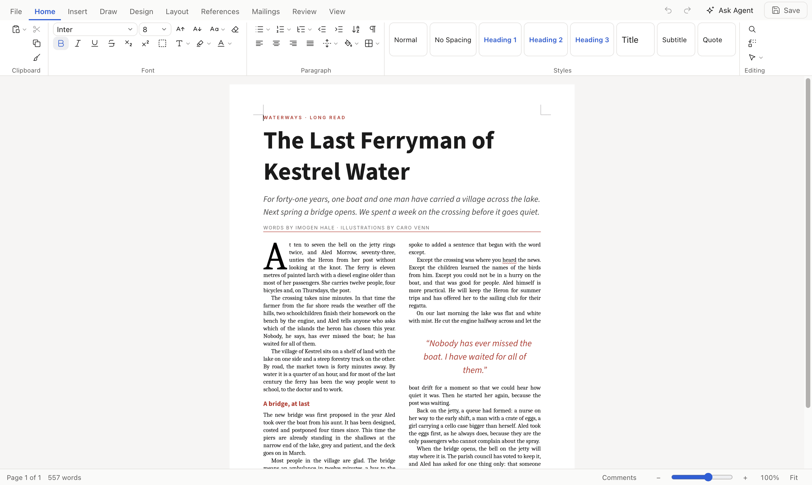
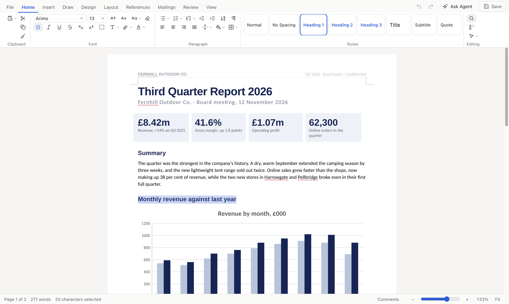
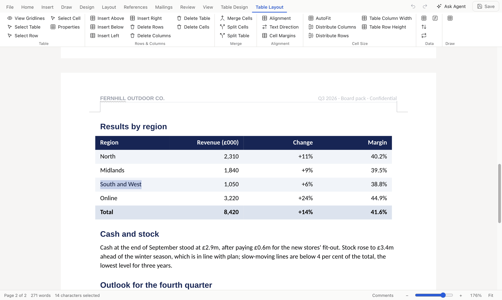
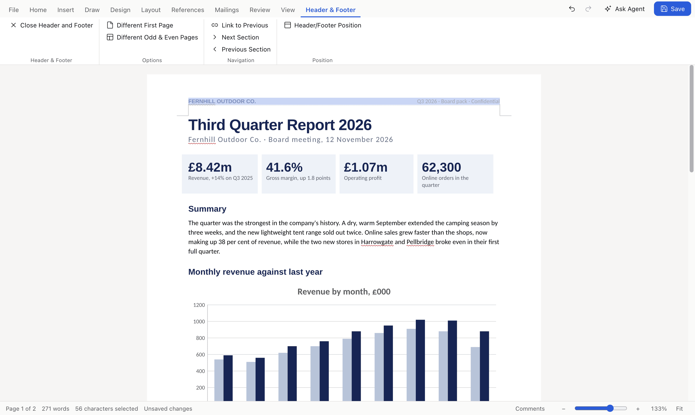
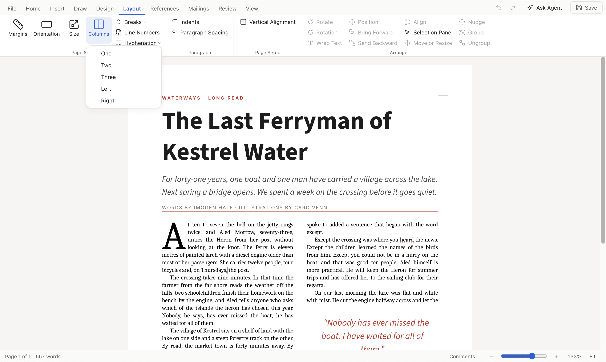
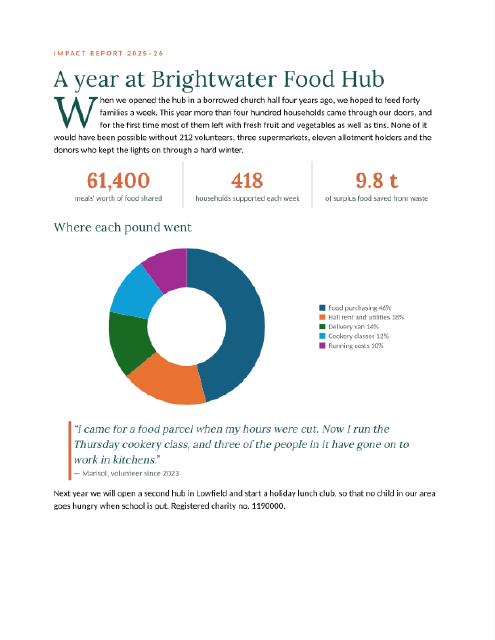
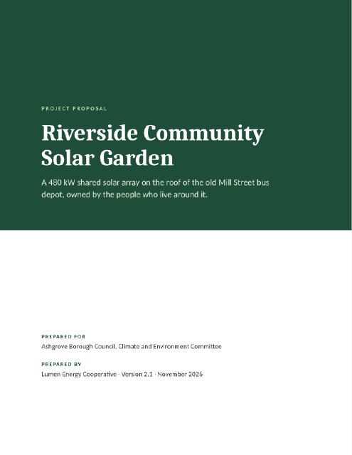
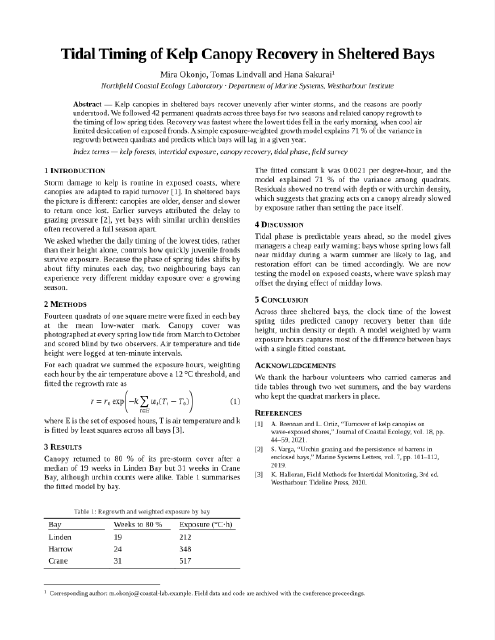
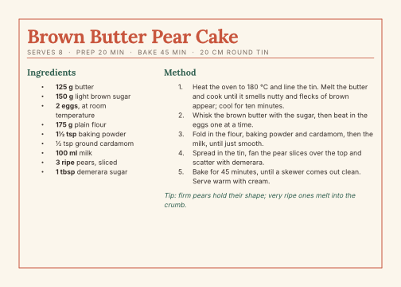

<div align="center">

# Kition Doc

**Kition Doc: a word processor for .docx files, for people and AI agents**

Styles and lists · Tables · Headers and footers · Columns and page setup · Agent tools with checks · Embeds in your app

[](LICENSE)
[](https://www.npmjs.com/package/@kition/embed)
[](https://github.com/kitharness/kitharness)
[](bindings/wasm)

[Use it in Kition](https://kition.ai) · [Embed it](#embed-it-in-your-app) · [Give it to your agent](#give-it-to-your-agent) · [Showcase](https://github.com/KitionAI/kition-showcase/tree/main/doc) · [Developer docs](https://developer.kition.ai) · [KHP](https://github.com/kitharness/kitharness)

</div>

A report is more than its words. It has styles, numbered lists, tables, headers and a page setup,
and many tools that open a `.docx` keep only part of that. Headings come back as bold text, a
table loses its widths, and the header is gone. An AI agent has it worse: it sees zipped XML, or
plain text that cannot hold a style.

Kition Doc is a word processor built around the `.docx` file. You work on pages, with a ribbon,
a styles gallery and real tables. An AI agent works on the same file through tools that run the
same engine and the same commands. It reads the paragraphs and tables, makes its change, and asks
the kit's check what still needs fixing.



## What it does

### Why Doc

- **Your `.docx` stays a `.docx`.** Open it, edit it, save it back in the same format. Styles,
  lists, tables, headers and footers and page setup have round-trip tests across save and reopen.
- **Everything a long document needs.** Styles from a gallery, bullets and multilevel numbering,
  tables with merged cells and sorting, sections with columns, breaks and hyphenation.
- **See the pages you will print.** Doc lays the document out page by page, with margins,
  headers, footers and page numbers. Show the full ribbon, a single line of tools, or none at all
  in Focus.
- **An agent works on the same file.** It reads the document's blocks, runs the commands the
  ribbon runs, and fixes what the check reports. Its edits can go to a draft that you review and
  merge.
- **Your files stay where they are.** Doc reads and writes only the files its host gives it, and
  starts no other program.
- **Open source, in Rust.** Apache-2.0, engine and editor. The engine is compiled to WebAssembly
  and runs in a Web Worker, off your page's main thread.

### See it

<table>
<tr>
<td width="50%"><br /><b>Styles</b>: titles, headings and quotes are styles, so every heading in a document looks alike. Pick one from the gallery.</td>
<td width="50%"><br /><b>Tables</b>: insert and delete rows and columns, merge and split cells, and size them from the Table Layout tab.</td>
</tr>
<tr>
<td width="50%"><br /><b>Headers and footers</b>: edit them on the page, and add page numbers from the Insert tab.</td>
<td width="50%"><br /><b>Columns and page setup</b>: margins, paper size, orientation, columns, breaks and hyphenation, from the Layout tab.</td>
</tr>
</table>

### Made with Doc

<table>
<tr>
<td width="25%"><a href="https://github.com/KitionAI/kition-showcase/tree/main/doc/charity-impact-report"></a></td>
<td width="25%"><a href="https://github.com/KitionAI/kition-showcase/tree/main/doc/project-proposal"></a></td>
<td width="25%"><a href="https://github.com/KitionAI/kition-showcase/tree/main/doc/kelp-research-paper"></a></td>
<td width="25%"><a href="https://github.com/KitionAI/kition-showcase/tree/main/doc/recipe-card"></a></td>
</tr>
</table>

Every sample is built with Doc's own commands. [See all of them](https://github.com/KitionAI/kition-showcase/tree/main/doc).

### Formats

| Opens | Creates | Exports |
| --- | --- | --- |
| `.docx` (edits and saves it); `.html`, `.htm` (to read) | `.docx` | `.pdf`, `.png` |

## Quick start

### Use it in Kition

In Kition, a `.docx` file opens in this editor. Kition's agent edits the same file with the kit's
`doc_*` tools. [Download Kition](https://github.com/KitionAI/kition/releases/latest).

### Embed it in your app

Doc's editor is a static package you host yourself, mounted into your page with
[`@kition/embed`](https://www.npmjs.com/package/@kition/embed). You keep the files and the users;
the editor reads and writes through the functions you give it.

1. Download `kition-doc-<version>.tgz` from the
   [latest release](https://github.com/KitionAI/kition-doc/releases/latest) and serve its
   `doc-ui/` folder as static files on its own origin, with the headers in the
   [embed reference](https://github.com/KitionAI/kition-sdk/blob/main/docs/platform/reference/embed.md).
2. Install the SDK and mount the editor:

```sh
npm install @kition/embed
```

```ts
import { KitionEmbed } from '@kition/embed'

const editor = await KitionEmbed.mount(document.getElementById('doc')!, {
  kit: { id: 'kit.doc', url: 'https://kits.example.com/doc-ui/' }, // the package you host
  file: { id: 'q3-report', name: 'Q3 report.docx' },
  storage: {
    read: async (id) => api.read(id),                    // { bytes, version }
    write: async (id, bytes, { expectedVersion }) =>     // refuse a stale version
      api.write(id, bytes, expectedVersion),             // { version }
  },
})
```

Every save carries the version it read, so an edit made elsewhere is never written over. Identity
and permissions, co-editing, and an agent's draft reviewed in your page are in the
[embed guide](https://github.com/KitionAI/kition-sdk/blob/main/docs/sdk/embed.md).

### Give it to your agent

The engine also runs headless, and `kition`, the Kition SDK's command line, serves it as MCP tools
(`doc_inspect`, `doc_run`, `doc_check`, …) on a folder of documents, for any MCP client. Nothing is
compiled: you need neither Rust nor the Kition app. Install `kition`, then connect your agent in the
folder:

```sh
npm install -g @kition/cli        # Node.js 20 or later; gives the kition command
kition agent add claude           # or codex, cursor: registers kition's MCP server
```

Without installing it:
`claude mcp add kition -- npx -y @kition/cli mcp --workspace "$PWD"`. Without Node.js, install
`kition` with `curl -fsSL https://github.com/KitionAI/kition-sdk/releases/latest/download/install.sh | sh`
(Windows: `irm https://github.com/KitionAI/kition-sdk/releases/latest/download/install.ps1 | iex`)
and run the same `kition agent add`.

`kition` holds no kit. The first time the agent opens a `.docx` file, through the `kit_inspect` tool
the server offers until Doc is installed, `kition` downloads Doc's headless executable into
`~/.kition/kits` and the doc tools appear. `kition kit install doc` downloads it ahead of time, and
`kition kit upgrade` moves it to the newest version. Claude Desktop, Cursor, Codex and the other
commands are in the SDK's
[agent guide](https://github.com/KitionAI/kition-sdk/blob/main/docs/sdk/agent.md#connect-your-agent)
and [`kition` guide](https://github.com/KitionAI/kition-sdk/blob/main/docs/sdk/cli.md). To run a
build of your own (working on the kit itself), see
[docs/development.md](docs/development.md#the-headless-kit-for-an-agent).

A real session on a copy of the showcase's quarterly report, abridged:

```text
> doc_inspect {"path":"report.docx","preview":false}
Opened `report.docx`: 692 × 1688
{"content":{"paragraphs":[{"index":0,"style":"Title","text":"Third Quarter Report 2026","type":"paragraph"}, …
  {"index":16,"style":"ListParagraph","text":"The board is asked to approve a third new store, in Castlewick, for opening in spring 2027.","type":"paragraph"}]},
 "details":{…,"words":271},"revision":"dsf1",…}

> doc_run {"path":"report.docx","steps":[
    {"command":"select.range","params":{"anchor":{"block":16,"off":22},"focus":{"block":16,"off":47}}},
    {"command":"format.bold"}]}
Ran 2 commands on `report.docx` (saved): 692 × 1688 Changes: objects 2 changed.

> doc_check {"path":"report.docx"}
Checked `report.docx`: no errors, no warnings, 3 notes.
{"diagnostics":[{"code":"doc.missing-alt-text","fix":{"command":"picture.altText"},
  "message":"A picture or chart has no alternative text: screen readers cannot describe it.",
  "severity":"info","target":{"page":1,"path":"body:6"}}, …]}

> doc_run {"path":"report.docx","steps":[{"command":"picture.altText","on":[1],
    "params":{"text":"Column chart of monthly revenue in 2025 and 2026, January to September; 2026 is higher every month."}}]}
Ran 1 commands on `report.docx` (saved): 692 × 1688 Changes: objects 2 changed; 0 new diagnostic(s), 1 resolved.
```

The agent bolded "approve a third new store", then gave the revenue chart (drawing object 1, as
`drawing.describe` lists it) the alternative text the check asked for. The two notes left say that
two of the report's fonts are drawn with substitutes on this machine. The agent's guide is
[agent/guide.md](agent/guide.md).

## Maturity

Version 0.1.2 · KHP 1.0, conformance level `basic`.

| Works today | Partly there | Not yet |
| --- | --- | --- |
| Typing, character and paragraph formatting<br />Styles, bullets and multilevel lists<br />Tables: rows, columns, merge and split, sorting<br />Headers, footers, page numbers and page setup<br />Agent tools that read, edit, check and fix, with drafts | Comments and tracked changes<br />Export to PDF and PNG; printing<br />Pictures, shapes, charts and equations<br />Table of contents, footnotes and citations<br />East Asian layout: line grids, punctuation compression, Chinese numbering | Laying out smart graphics (they show their stored drawing)<br />Saving content controls back to the file<br />Shadow, glow, reflection and 3-D effects on text<br />Recolor, duotone and artistic effects on pictures |

Known gaps: [docs/gaps.md](docs/gaps.md). What's next: [docs/roadmap.md](docs/roadmap.md).

## Build and contribute

Build and test instructions are in [docs/development.md](docs/development.md). Read
[CONTRIBUTING.md](.github/CONTRIBUTING.md) before opening a pull request, and ask questions in
[Discussions](https://github.com/KitionAI/kition/discussions) or on [Discord](https://discord.gg/bFSjRDjVY).

## License

Apache-2.0 ([LICENSE](LICENSE)). Third-party licenses and notices are listed in [NOTICE](NOTICE)
and [docs/attribution.md](docs/attribution.md).

Portions of this kit are derived from a project dual-licensed under MIT or Apache-2.0, used here under the MIT License and credited in [NOTICE](NOTICE).
